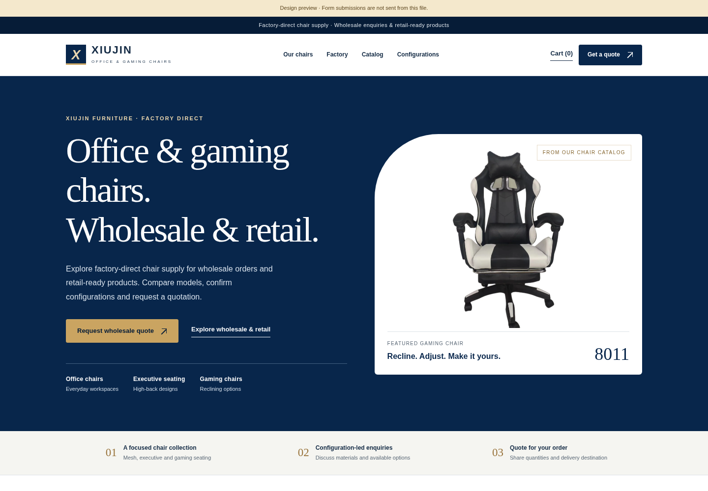

# XIUJIN Shopify 主题交付包

这是为 **Bazhou Xiujin Furniture Co., Ltd / XIUJIN** 制作的 Shopify Online Store 2.0 主题，面向办公椅、电竞椅和高背办公椅的工厂批发与零售。

## 直接下载

- [下载新版 Shopify 主题 ZIP](https://github.com/chunboye7-tech/tt/raw/refs/heads/main/XIUJIN-theme.zip)
- [下载主题预览 PDF](https://github.com/chunboye7-tech/tt/raw/refs/heads/main/XIUJIN-preview.pdf)
- [下载本地交互预览 ZIP](https://github.com/chunboye7-tech/tt/raw/refs/heads/main/XIUJIN-Store-Preview.zip)
- [下载 18 个草稿商品 CSV](https://github.com/chunboye7-tech/tt/raw/refs/heads/main/XIUJIN-products-DRAFT.csv)
- [下载 58 个外观配置对应表](https://github.com/chunboye7-tech/tt/raw/refs/heads/main/XIUJIN-58-visual-configurations.csv)
- [下载 58 张商品图片 ZIP](https://github.com/chunboye7-tech/tt/raw/refs/heads/main/XIUJIN-58-product-images.zip)

## 上传主题

1. Shopify 后台 → **在线商店 / Online Store** → **主题 / Themes**。
2. 点击 **Import / 导入主题** → **Upload zip file**。
3. 选择下载后的 `XIUJIN-theme.zip`，不要先解压。
4. 上传后先点击 **Preview**；确认无误后再 **Publish**。

新版包含 10 张主页图、3 张工厂流程插画、18 个商品系列、交互式 3D 椅子、批发询价、零售商品模板、购物车、滚动动画、SEO、英文/西班牙语/葡萄牙语界面，以及 Facebook、Instagram、TikTok、WhatsApp、Messenger 链接设置。

商品 CSV 全部保持 `draft` 和 `Published=FALSE`。原始价目表没有明确价格币种，因此没有写入售价；确认币种、库存、运费和正式价格后再发布。

## 说明与验证

- [中文安装与使用说明](INSTALLATION-GUIDE-CN.md)
- [首页文案与 SEO 设置](CONTENT-SEO-GUIDE-CN.md)
- [终检结果](VALIDATION-CN.md)

工厂图片当前是清楚标注的场景插画。获得真实工厂照片后，请在主题编辑器的 **Factory and supply** 区块中替换。

